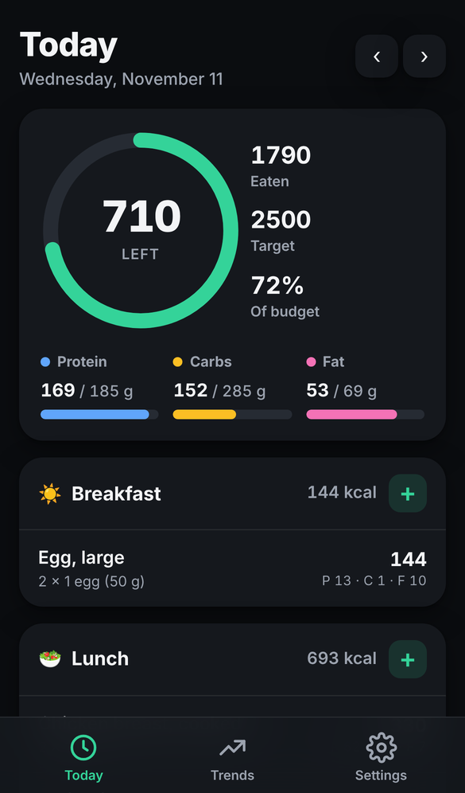
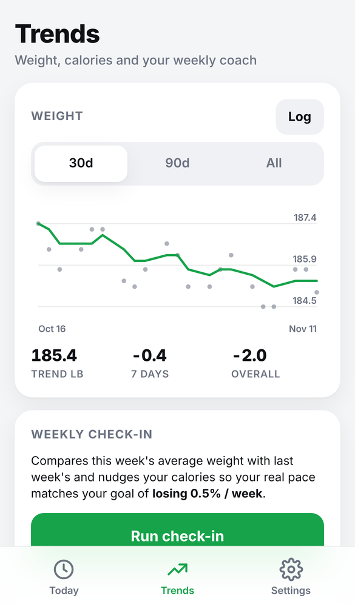
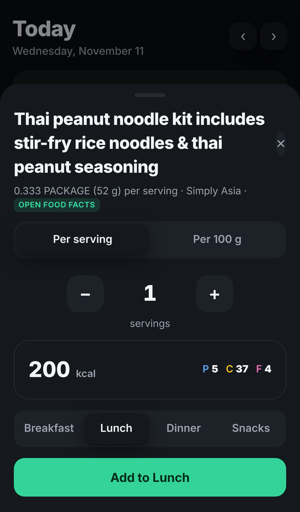

# Macro Log

A simple, beautiful macro and meal tracker in the spirit of Carbon Diet Coach. It is a Progressive Web App: open it in Safari, add it to your Home Screen, and it runs full-screen on iPhone, works offline, and keeps all data on your device.

<p align="center">  </p>

## What it does

- **Onboarding** estimates your maintenance calories (Mifflin–St Jeor × activity) and sets calorie and macro targets for your goal and pace.
- **Today** shows a calorie ring, protein/carb/fat bars, and your meals (breakfast, lunch, dinner, snacks). Swipe through days with the arrows.
- **Logging** from a built-in database of 8,000+ generic foods (USDA Standard Reference, public domain) plus ~150 curated everyday foods with friendly names and servings, your recent foods, custom foods you create, or a quick macro entry. Adjust servings with a stepper or type a decimal.
- **Forgiving search**: plurals ("eggs" finds Egg), typos ("chiken"), synonyms ("pb", "yoghurt", "prawns"), any word order. When nothing local matches, it searches Open Food Facts automatically.
- **Barcode scanning** with the camera (ZXing, runs on-device) looks products up in **Open Food Facts**, with a per-serving / per-100 g toggle. Custom foods remember their barcode, and anything you have looked up before works offline.
- **Online search** of Open Food Facts from the add sheet when the bundled list does not have what you ate. Add a free USDA FoodData Central key in Settings to search US branded products too.
- **Weight trend** with a smoothed trend line over 30/90/all days.
- **Weekly check-in** compares this week's average weight with last week's and nudges calories (max ±150 kcal per week) so your real pace matches your target. Protein stays fixed; carbs and fat are re-split.
- **Settings** for targets, profile, units (lb/kg), light/dark/auto theme, and JSON export/import.
- **Optional Google Drive sync.** Each person can connect their own Google account and the app keeps one file in a private app folder of their Drive, so data follows them across devices. Nothing is stored centrally. Changes from several devices merge record by record with timestamps and deletion tombstones. See `docs/google-drive-setup.md` to enable it for a deployment.

## Run it locally

```bash
npm start          # serves on http://localhost:8080
npm test           # nutrition math tests (node:test, no dependencies)
```

Any static file server works. There is no build step.

## Put it on your iPhone

1. Host the folder somewhere over HTTPS. The included GitHub Pages workflow does this: in the repository settings, set **Pages → Source** to **GitHub Actions**, then push to `main`.
2. On your iPhone, open the URL in **Safari**.
3. Tap **Share → Add to Home Screen**.

The app launches full-screen with its own icon, and the service worker keeps it working without a connection.

## Project layout

```
index.html              shell
styles.css              design tokens, light + dark themes, components
manifest.webmanifest    PWA manifest
sw.js                   offline cache (bump CACHE when you ship changes)
src/app.js              views, sheets, events
src/nutrition.js        pure math: BMR/TDEE, macro split, trend, weekly check-in
src/foods.js            curated everyday foods
src/search.js           forgiving search (stemming, typos, aliases, ranking)
data/foods-sr.json      USDA SR28 generic foods, built by tools/build-sr.py
src/lookup.js           Open Food Facts + USDA lookups and normalizers
src/store.js            localStorage persistence, import/export, merge logic for sync
src/drive.js            Google sign-in (redirect flow) and Drive appDataFolder client
src/sync.js             pull → merge → push orchestration, token handling
src/config.js           public Google OAuth client ID for the deployment
privacy.html            privacy page to link from the Google consent screen
vendor/zxing.min.js     ZXing barcode decoder (Apache 2.0)
tests/                  node:test suite for nutrition.js
tools/make-icons.py     regenerates icons/ (needs Pillow)
```

## Food databases

- **USDA Standard Reference (SR28)** is bundled as `data/foods-sr.json` (about 190 KB compressed) and loaded the first time you open the add sheet, then cached offline. Rebuild it with `tools/build-sr.py`; the docstring explains where the source files come from. It is US public domain.

- **Open Food Facts** is used for barcode lookups and online search. It is free and needs no key. The app identifies itself with `app_name` / `app_version` query parameters as their docs ask of web apps. Their read limit is 100 product lookups per minute per user and search is much more limited, so search is a button rather than live-as-you-type.
- **USDA FoodData Central** is optional. Paste a free key from api.data.gov into Settings and it is added to barcode lookups (US branded products) and search. The key stays in your browser's storage.
- Product data is © Open Food Facts contributors under the Open Database License, and USDA data is public domain.

## Sync

Local-only is the default. To let people connect Google Drive, follow `docs/google-drive-setup.md` once: it creates a free OAuth client in Google Cloud whose public ID goes in `src/config.js`. Each user then signs in with their own Google account from Settings (or "Restore from Google Drive" on the welcome screen of a new device) and their data lives only in their own Drive.

## Notes

- Data lives in `localStorage` under `macrolog.v1`. Export a backup from Settings before clearing Safari data, or connect Google Drive.
- Bundled food values are typical label/USDA figures for everyday logging, not a clinical database. Scanned products come from crowdsourced data, so check anything that looks off.
- Camera access needs HTTPS (GitHub Pages is fine) and, on iPhone, Safari or the Home Screen app.
- Not medical advice.
